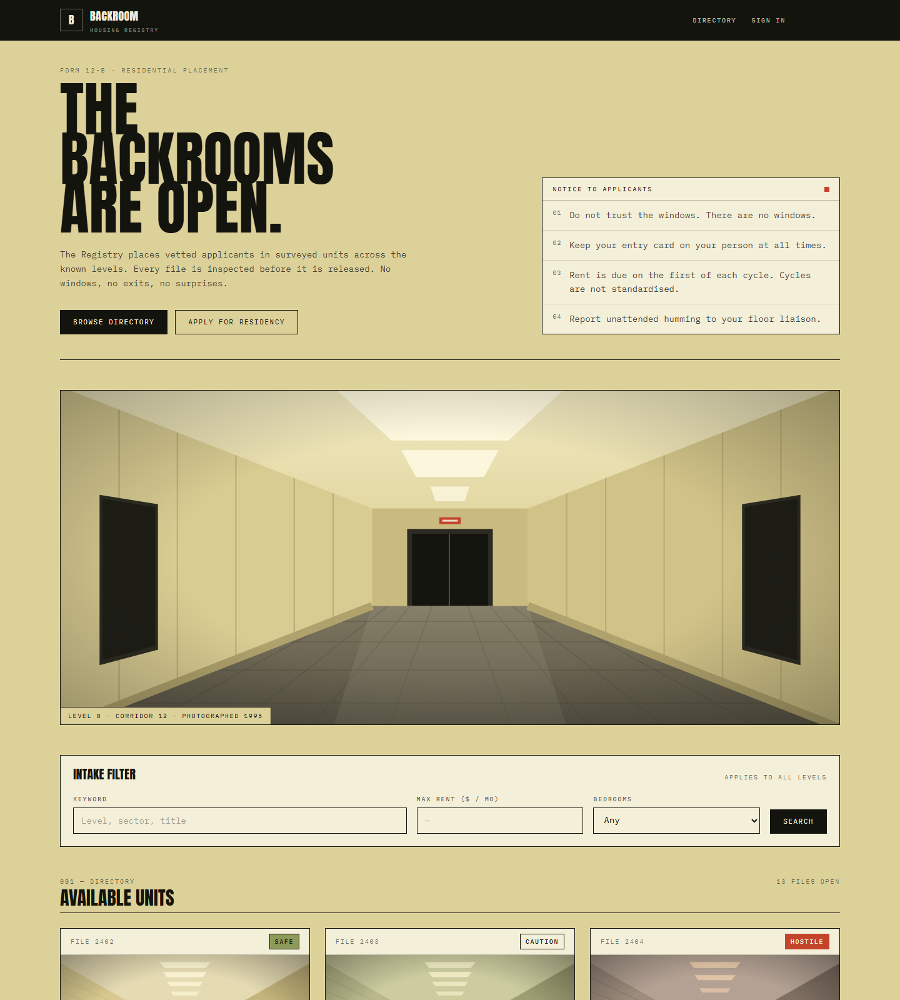
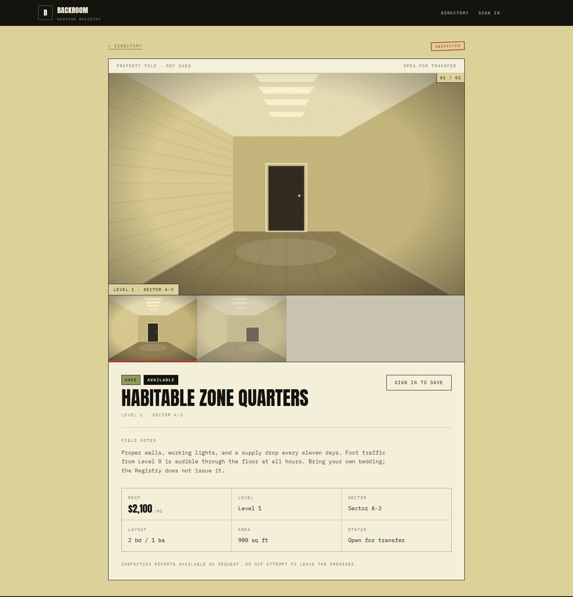
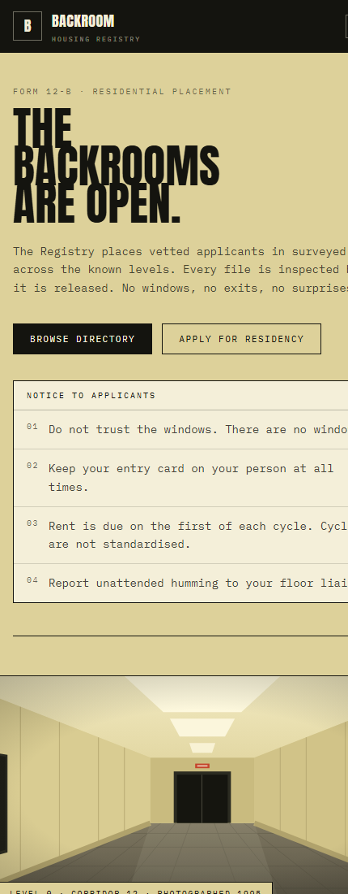
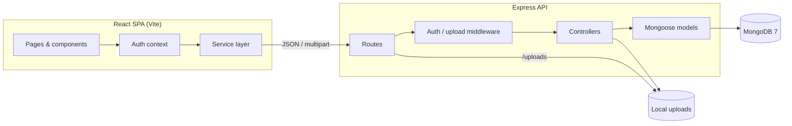

# Backroom Housing Registry

[](https://github.com/junjhon12/backroom-housing/actions/workflows/ci.yml)

A full-stack housing platform for the Backrooms — a fictional residential registry where renters browse surveyed units, save files, and hosts manage listings. Built as a production-shaped MERN application: typed end to end, authenticated, indexed, validated, and fully seeded.

> **Live demo:** _add deployment URL here_
>
> **Demo host account:** `host@backroom.local` / `password123`



## What it does

**Public directory**
- Keyword search backed by a MongoDB text index (title, level, sector, description)
- Rent ceiling and minimum-bedroom filters, all encoded in the URL so searches are shareable and the back button works
- Server-side pagination with total counts
- Listing gallery with cover image and up to six photographs
- Hazard classification (`safe` / `caution` / `hostile`) surfaced consistently across cards, detail pages, and the host console
- Designed loading skeletons, empty states, error states, and a 404 route

**Accounts**
- Register and sign in with hashed passwords (bcrypt) and JWT sessions
- Public registration can only create `renter` accounts; privileged roles are granted out of band
- Saved-file favorites with optimistic UI and rollback on failure
- Route guards for authenticated and role-restricted pages, with redirect-back-after-login

**Host console**
- Create, edit, withdraw, and reactivate listings
- Ownership checks on every mutation (admins may act on any listing)
- Image upload with MIME/extension checks, magic-byte verification, a 5 MB cap, and cleanup of files when a listing is deleted
- Server-managed availability toggling

**Platform**
- Strict TypeScript across both workspaces
- Centralised API error contract (`{ success, data }` / `{ success, error }`)
- Mongoose validation and indexes for the real query paths
- Idempotent seed script with generated survey photography

| Desktop file view | Mobile directory |
| --- | --- |
|  |  |

## Tech stack

| Layer | Choice |
| --- | --- |
| Frontend | React 19, TypeScript, Vite, React Router 7, Tailwind CSS v4 |
| Backend | Node.js, Express 4, TypeScript, Mongoose 8 |
| Database | MongoDB 7 (Docker for local development) |
| Auth | JWT bearer tokens, bcrypt password hashing |
| Uploads | Multer disk storage + magic-byte validation |
| Tooling | npm workspaces, tsx, Oxlint, Vitest |

## Architecture



### Repository layout

```text
backroom-housing/
├─ apps/
│  ├─ backend/
│  │  ├─ src/
│  │  │  ├─ config/        # DB connection and paths
│  │  │  ├─ controllers/   # Auth, property, user handlers
│  │  │  ├─ middleware/    # JWT auth, errors, Multer
│  │  │  ├─ models/        # User and Property schemas
│  │  │  ├─ routes/        # REST route definitions
│  │  │  ├─ scripts/       # Seed, index sync, seed imagery
│  │  │  ├─ types/         # Shared API response types
│  │  │  └─ utils/         # AppError, async handler, validators
│  │  └─ uploads/          # Generated/uploaded photographs
│  └─ frontend/
│     ├─ src/
│     │  ├─ components/    # UI primitives and shared components
│     │  ├─ context/       # Auth provider
│     │  ├─ lib/           # Display formatting
│     │  ├─ pages/         # Directory, file, auth, console
│     │  └─ services/      # Typed fetch wrappers
│     └─ public/           # Static scene art and icons
├─ docs/screenshots/
├─ docker-compose.yml      # Local MongoDB
└─ package.json            # Workspace scripts
```

## Getting started

### Prerequisites

- Node.js 18+ (tested on Node 20 and 26)
- npm 9+
- Docker Desktop (or another MongoDB 7 instance)

### 1. Install dependencies

```bash
npm install
```

### 2. Configure the backend

```bash
cp apps/backend/.env.example apps/backend/.env
```

| Variable | Purpose | Default |
| --- | --- | --- |
| `PORT` | API port | `5000` |
| `FRONTEND_URL` | Allowed CORS origin | `http://localhost:5173` |
| `MONGO_URI` | MongoDB connection string | `mongodb://127.0.0.1:27017/backroom_housing` |
| `JWT_SECRET` | Token signing secret — **change this** (32+ characters in production) | _(required)_ |
| `NODE_ENV` | `production` enables the proxy-aware rate limiter and secret-length check | `development` |

### 3. Start MongoDB and seed the registry

```bash
npm run db:up
npm run db:seed
```

The seed is idempotent: it recreates 13 listings owned by the demo host and generates their survey photographs into `apps/backend/uploads/`. Real user accounts and non-seed uploads are left intact.

### 4. Run both workspaces

```bash
npm run dev
```

| Service | URL |
| --- | --- |
| Frontend | http://localhost:5173 |
| API | http://localhost:5000 |
| Health check | http://localhost:5000/api/health |

> If port 5173 is already taken, Vite picks the next free port. The frontend proxies `/api` and `/uploads` to port 5000.

### Demo accounts

| Role | Email | Password |
| --- | --- | --- |
| Host | `host@backroom.local` | `password123` |
| Renter | register a new account | — |

Sign in as the host to see the **Console** navigation entry, create listings, and manage uploads.

## Scripts

Run from the repository root:

| Command | Description |
| --- | --- |
| `npm run dev` | Run API and frontend together |
| `npm run build` | Type-check and build both workspaces |
| `npm run typecheck` | Type-check without emitting |
| `npm run lint` | Lint the frontend with Oxlint |
| `npm test` | Run backend and frontend test suites |
| `npm run db:up` / `db:down` | Start / stop local MongoDB |
| `npm run db:seed` | Recreate demo data and imagery |
| `npm run setup` | `db:up` followed by `db:seed` |
| `npm run sync-indexes -w @backroom-housing/backend` | Rebuild MongoDB indexes |

## API

All responses are JSON and follow one of two shapes:

```jsonc
{ "success": true, "data": { /* payload */ } }
{ "success": false, "error": "Human-readable message" }
```

Paginated collections also include `meta: { page, limit, total, totalPages }`.

| Method | Endpoint | Access | Description |
| --- | --- | --- | --- |
| `GET` | `/api/health` | Public | Service health check |
| `POST` | `/api/auth/register` | Public | Create a renter account |
| `POST` | `/api/auth/login` | Public | Exchange credentials for a JWT |
| `GET` | `/api/properties` | Public | Browse available listings |
| `GET` | `/api/properties/:id` | Public | Fetch one listing |
| `GET` | `/api/properties/me` | Host/Admin | Listings owned by the caller |
| `POST` | `/api/properties` | Host/Admin | Create a listing |
| `PUT` | `/api/properties/:id` | Owner/Admin | Update a listing |
| `DELETE` | `/api/properties/:id` | Owner/Admin | Delete a listing and its images |
| `POST` | `/api/upload` | Host/Admin | Upload one image (`image` field) |
| `GET` | `/api/users/favorites` | Authenticated | Saved listings |
| `POST` | `/api/users/favorites/:propertyId` | Authenticated | Toggle a saved listing |

**Query parameters for `GET /api/properties`**

| Parameter | Type | Notes |
| --- | --- | --- |
| `keyword` | string | Full-text search across title, level, sector, description |
| `minPrice` / `maxPrice` | number | Inclusive rent bounds; `minPrice ≤ maxPrice` |
| `bedrooms` | number | Minimum bedroom count |
| `page` | integer | Defaults to `1` |
| `limit` | integer | Defaults to `20`, capped at `100` |

## Data model

**User** — `name`, `email` (unique, normalised), `password` (bcrypt hash), `role` (`renter` / `host` / `admin`), `savedProperties[]`.

**Property** — lore-specific address (`level`, `sector`), `title`, `description`, `price`, `hazardClass`, `bedrooms`, `bathrooms`, `squareFeet`, `isAvailable`, `images[]` (max 6, local upload paths only), owning `host`.

Indexes cover the actual access patterns:

- text index on `title`, `level`, `sector`, `description`
- `{ isAvailable: 1, createdAt: -1 }` for the default feed and pagination
- `{ isAvailable: 1, price: 1 }` and `{ isAvailable: 1, bedrooms: 1 }` for independent filters
- `{ host: 1, createdAt: -1 }` for the host console

## Security decisions

- Passwords hashed with bcrypt; the hash is never returned by the API
- JWTs verified on every protected request; the user is re-read from the database so deleted/revoked accounts fail closed
- Token payload contains only the user id
- Public registration cannot self-assign `host` or `admin`
- Mutations derive `host` from the token, never from the request body; only an explicit allow-list of fields is writable
- Ownership is checked before update/delete, with an admin override
- Uploads check extension and MIME type, then verify PNG/JPEG/WebP magic bytes before keeping the file
- Uploaded filenames are randomised; listings may only reference `/uploads/<file>` paths
- CORS restricted to `FRONTEND_URL`
- Helmet security headers; the framework banner is removed
- Rate limits on the whole API, plus stricter limits on authentication and uploads
- JSON bodies capped at 100 KB; malformed or oversized bodies return 400/413
- Required environment variables are validated at boot instead of failing on first use
- Invalid ObjectIds, query params, and payloads return a consistent 400 rather than a 500

## Testing

The backend suite runs against a real MongoDB instance through Supertest, so authentication, ownership checks, validation, pagination, text search, favorites, and upload handling are exercised end to end. The frontend suite uses Vitest, jsdom, and React Testing Library.

```bash
npm run db:up   # tests use mongodb://127.0.0.1:27017/backroom_housing_test
npm test
```

CI runs lint, type-checking, both test suites (with a MongoDB service container), and the production build on every push and pull request.

## Known limitations

This is a portfolio project, not a production service. The next planned steps are:

- Renter application/inquiry flow and a host inbox
- Admin moderation console
- Move uploads to object storage and generate responsive image variants
- Refresh-token rotation with httpOnly cookies
- Sorting and hazard/level filters in the directory

## License

MIT
